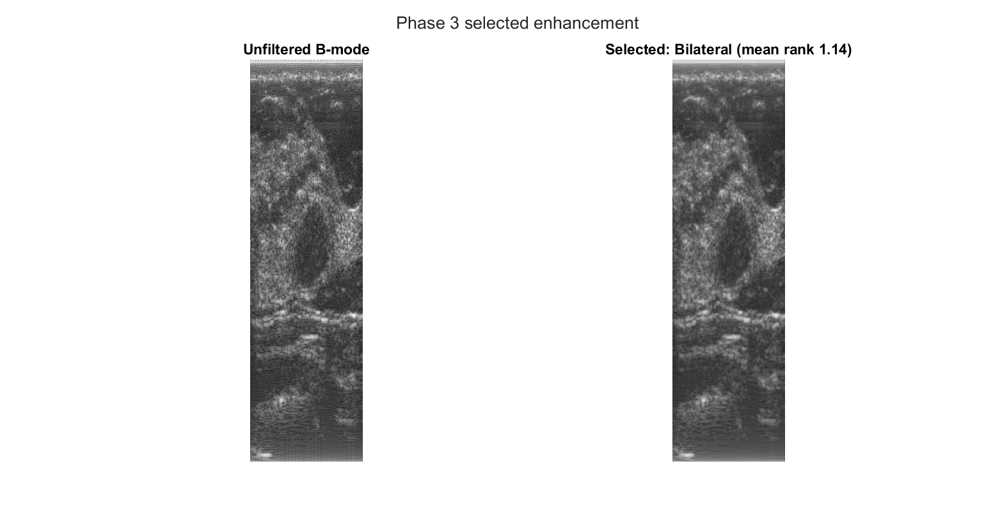

# Real-Time Acceleration for Medical Image Processing

**MathWorks MATLAB-Simulink Challenge Project**
Rohith Ram V | 24BCE0543 | B.Tech CSE | VIT Vellore

An end-to-end pipeline for breast ultrasound: raw OASBUD RF data goes in, a benign or malignant decision comes out, deployed with NVIDIA Holoscan SDK on an RTX 4070 Laptop GPU, with reconstruction accelerated by GPU Coder-generated CUDA. A second Holoscan pipeline runs plane-wave delay-and-sum beamforming on real per-element channel data. Every number in this README names the script that produces it and the saved output file it comes from; the [Reproduce](#reproduce) section lists the commands in order.

This version answers the MathWorks review. `RESPONSE_TO_REVIEW.md` maps each review item to the commit that addresses it.

---

## Pipeline Architecture

```
OASBUD RF data [1]
     |
     v
DataSourceOp        -- loads .mat file, emits OASBUD hold-out patients one at a time
     |
     v
BeamformingOp       -- per-column Hilbert envelope + power law compression (gamma=0.3)
                        GPU Coder CUDA kernel if available, scipy fallback otherwise
     |
     v
EnhancementOp       -- uint8 scaling -> bilateral filter -> resize 224x224 bilinear -> RGB
     |
     v
InferenceOp         -- ONNX MobileNetV2 via CUDAExecutionProvider, normal merged into benign
     |
     v
OutputOp            -- record prediction, print summary, save results to RESULTS_DIR
```

**Why two pipelines exist, in one sentence:** OASBUD's RF data is not per-element channel data, so delay-and-sum beamforming, its GPU Coder kernel and the Phased Array System Toolbox run on a second dataset that is (Pipeline 2, below). The reasoning is in [Dataset Strategy](#dataset-strategy-why-oasbud-and-the-plane-wave-phantom-dataset-serve-different-roles).

---

## Dataset Strategy: Why OASBUD and the Plane-Wave Phantom Dataset Serve Different Roles

This project uses two raw ultrasound sources for two different purposes.

### Why OASBUD is not used for delay-and-sum beamforming or the Phased Array System Toolbox

Each of OASBUD's 510 RF columns is already a pre-formed scan line: the clinical scanner beamformed the data before it was saved. There is no element geometry left for delay-and-sum, the GPU Coder `das_beamform` kernel, or any Phased Array System Toolbox beamformer to use, and running them on OASBUD gives an incoherent image. The method used for OASBUD everywhere in the deployed pipeline is per-column Hilbert envelope detection with power-law compression (`BeamformingOp`, GPU Coder-accelerated through `aline_reconstruct.m`), which needs no delays and no array geometry. The DAS-family comparison in `Phase5_ReconstructionComparison.m` is run on OASBUD only as a documented comparison, not as part of the pipeline.

### Why the plane-wave phantom dataset cannot replace OASBUD for classification

The Ultrasound Plane Wave Raw Data, 75 Angles dataset [6] is genuine per-element channel data, which makes it the right input for delay-and-sum on the GPU and for the Phased Array System Toolbox. It is acquired from physical test phantoms, not patients, and carries no benign or malignant labels, so it cannot contribute to or validate any classification number.

| | OASBUD | Plane-wave phantom dataset [6] |
|---|---|---|
| Data type | Pre-formed scan lines | Raw per-element channel data |
| Used for | Classification, via GPU Coder-accelerated per-column Hilbert | Delay-and-sum GPU Coder CUDA and Phased Array System Toolbox (Pipeline 2) |
| Not used for | Delay-and-sum beamforming, Phased Array System Toolbox | Any classification claim (no disease labels exist) |

### OASBUD label convention

The OASBUD `class` field is 0 for benign and 1 for malignant. The file has 48 class-0 and 52 class-1 records, matching the 48 benign and 52 malignant lesions reported for OASBUD, and the BI-RADS field agrees (31 of the 48 class-0 records are BI-RADS 3, while 50 of the 52 class-1 records are BI-RADS 4b, 4c or 5). Earlier versions of this repository used the opposite mapping. Every script now uses the convention above, and all results in this README were produced after the fix.

---

## CNN Training and Evaluation

### Training data

`buildCombinedDatastore.m` is the only place the five datasets are loaded; training and evaluation both call it.

| Dataset | Images | Source |
|---|---|---|
| BUSI [2] | 780 | Standard benchmark, clinical scanner PNG |
| BUS-UCLM [3] | 646 | Doppler images excluded |
| BUS-BRA [4] | 1875 | Zenodo |
| BrEaST [5] | 256 | Cancer Imaging Archive, CC-BY 4.0, mask files excluded |
| OASBUD-PNG [1] | 880 | First 20 benign and first 20 malignant OASBUD patients, A-line reconstruction, base image, second view and 20 imageDataAugmenter copies each |
| **Total** | **4437** | Train 3080 / Val 721 / Test 636 |

Source: `results/training_log.txt` and `results/logs/Phase6_CNN_Evaluation.txt`.

`Phase4_MegaTrain.m` makes a single 70/15/15 split, stratified by class and grouped by patient: all images of one OASBUD patient, both views of a BUS-BRA case and all images with the same BUS-UCLM patient prefix land in the same partition. The file keys and the seed (42) are saved to `MATLAB Codes/cnn_split.mat`, and `Phase6_CNN_Evaluation.m` loads that list instead of splitting again. The network is MobileNetV2 from `imagePretrainedNetwork`, trained with `trainnet` for 30 epochs (Adam, learning rate 1e-4, mini-batch 16) with a cross-entropy class weight of 1.5 for malignant and 1.0 for the other classes. The 60 OASBUD patients that were not exported are never seen in training and form the pipeline hold-out set.

### Results on the hold-out test set (636 images)

Source: `MATLAB Codes/Phase6_CNN_Evaluation.m`, output `results/cnn_eval.md` and `results/cnn_eval.mat`.

| Class | Precision | Recall | F1 | Support |
|---|---|---|---|---|
| benign | 84.72% | 84.27% | 0.8449 | 375 |
| malignant | 74.65% | 75.00% | 0.7482 | 212 |
| normal | 90.00% | 91.84% | 0.9091 | 49 |

**Overall test accuracy: 81.76% (520/636).** Malignant vs rest: AUC-ROC **0.9105**, AUC-PR **0.8154**. The confusion matrix, ROC and PR curves are in `results/figures/Phase6/`.

### ONNX export

`exportONNXNetwork` on the trained `dlnetwork`, committed as `MATLAB Codes/trainedMobileNetV2_mega.onnx`. Input node `input_1`, shape [N 3 224 224], raw float32 values 0 to 255 (the normalisation is inside the graph). Output node `Logits_softmax`, already softmax probabilities, class order benign, malignant, normal. On the 10 bundled sample tiles MATLAB and ONNX Runtime pick the same class for all 10, with a largest probability difference of 2.731e-3 (`results/logs/onnx_parity.txt`).

---

## Pipeline 1 Results: OASBUD hold-out patients

Source: `Holoscan/Phase6_Pipeline_Benchmark.py` on the full OASBUD file, output `results/logs/pipeline1_benchmark_holdout.txt` and `results/pipeline1_benchmark/`. The benchmark calls the same functions as the Holoscan operators and scores only the 60 hold-out patients (28 benign, 32 malignant).

**Pipeline accuracy (hold-out patients only): 55.0% (33/60).** Malignant recall 84.4% (27/32), benign recall 21.4% (6/28). The model calls most OASBUD images malignant (49 of 60), so on this dataset it catches most cancers but rejects few benign lesions.

The same patients evaluated in MATLAB (Section 9 of `Phase6_CNN_Evaluation.m`, same preprocessing steps) give 56.7% (34/60), malignant recall 84.4%, benign recall 25.0% (`results/logs/Phase6_CNN_Evaluation.txt`). The one-patient difference comes from MATLAB `imresize` against PIL resize and from the float32 GPU filter.

For reference only, scoring all 100 OASBUD records, **including the 40 training patients**, gives 68.0% (`results/logs/pipeline1_benchmark_all_records.txt`). That figure is not a hold-out result.

### Latency (60 hold-out frames, RTX 4070 Laptop GPU)

| Stage | CUDA beamforming (ms) | scipy beamforming (ms) |
|---|---|---|
| Beamforming | 16.51 | 25.25 |
| Enhancement (bilateral, cupy) | 8.16 | 8.46 |
| Preprocess | 0.05 | 0.05 |
| ONNX Inference | 3.34 | 3.38 |
| **Total** | **28.07** | **37.15** |
| Throughput (mean) | 35.6 fps | 26.9 fps |
| Throughput (95th percentile) | 21.8 fps | 16.1 fps |

Sources: `results/logs/pipeline1_benchmark_holdout.txt` and `results/logs/pipeline1_benchmark_holdout_scipy.txt`. Accuracy is identical with both backends (33/60).

### GPU Coder CUDA acceleration

The A-line reconstruction (`MATLAB Codes/aline_reconstruct.m`) is compiled to CUDA with GPU Coder and loaded into `BeamformingOp` through ctypes. On all 100 OASBUD patients the CUDA output matches the scipy reference with a largest absolute difference of 7.64e-13 (`Holoscan/aline_cuda_verify.py`, output `results/logs/aline_cuda_verify.txt`). `das_beamform.m` / `das_beamform.cu` is an earlier GPU Coder target implementing delay-and-sum; it is kept as a comparison method and is not used for OASBUD.

---

## Pipeline 2: Plane Wave Beamforming (Real-Time Acceleration Demonstration)

A separate Holoscan application, `HoloscanPlaneWave/`, runs genuine per-element channel data. It shares only the enhancement filter with Pipeline 1 and has no classification stage, because the CIRS040GSE phantom has no disease labels.

```
CIRS040GSE plane wave RF data [6]
     |
     v
DataSourceOp        -- loads HDF5 frame, applies lens delay + angle delay +
                        channel 125 corrections (real per-element channel data)
     |
     v
BeamformingOp       -- plane-wave delay-and-sum, single broadside angle
                        GPU Coder CUDA kernel if available, numpy fallback otherwise
     |
     v
EnhancementOp       -- envelope detection -> log compression -> bilateral filter
                        (viewable B-mode image, not a classifier input tile)
     |
     v
OutputOp            -- save reconstructed frame to RESULTS_DIR, print timing
```

### Why the physics is different here

All elements fire together to form a flat wavefront, so the transmit delay follows the wavefront angle rather than the distance to one element; only the receive half uses the per-element spherical delay. This is `das_beamform_planewave.m`, distinct from `das_beamform.m`.

### GPU Coder CUDA acceleration

`das_beamform_planewave.m` is generated with variable-size inputs and built as a Linux shared library in WSL2. The CUDA output matches the numpy reference with zero difference on 5 real frames at the broadside angle (`HoloscanPlaneWave/das_cuda_planewave_verify.py`, output `results/logs/das_cuda_planewave_verify.txt`).

### Reconstruction methods and toolbox use

**Delay-and-sum (`das_beamform_planewave.m`)** is the live, GPU Coder-accelerated method.

**F-k migration (`fk_migration_planewave.m`, `fk_migration_planewave_multiangle.m`)** is a comparison method, reimplemented with attribution from Garcia D et al., "Stolt's f-k migration for plane wave ultrasound imaging," IEEE Trans Ultrason Ferroelectr Freq Control, 2013;60:1853-1867. On a real wire-target frame, compounding all 75 angles raises the contrast-to-noise ratio from 121.9 to 199.2 (63.4%) against a single angle, measured on the raw envelope; the background standard deviation falls from 20.53 to 12.05 (`FK_Migration_MultiAngle_Test.m`, output `results/logs/FK_Migration_MultiAngle_Test.txt`).

**Phased Array System Toolbox on real data.** `Phase7_PhasedArrayToolbox_RealData.m` uses `phased.ULA` with the real array geometry (128 elements, 0.195 mm pitch from the dataset header). It applies `phased.PhaseShiftBeamformer` toward broadside, and forms a 2-D image with `phased.TimeDelayBeamformer` swept over 201 receive steering angles from -25 to 25 degrees. That image is shown beside the hand-written DAS image of the same frame in `results/figures/Phase5/toolbox_tdb_vs_das.png`. The toolbox beamformer assumes far-field arrivals, so the near-field wires appear as arcs rather than points; the custom DAS kernel stays the GPU Coder target.

**MVDR.** `Phase5_ReconstructionComparison.m` uses `phased.MVDRBeamformer` for its adaptive method, applied per image column after delay alignment. MATLAB warns that the depth samples per column are fewer than twice the 510 degrees of freedom, so the covariance estimate is heavily regularised by diagonal loading (`results/logs/Phase5_ReconstructionComparison.txt`). Element positions in the OASBUD comparison scripts come from `phased.ULA` and `getElementPosition`.

### Pipeline benchmark

Source: `HoloscanPlaneWave/PlaneWave_Pipeline_Benchmark.py` over all 20 low-attenuation CIRS040GSE frames, single broadside angle, CUDA beamforming, output `results/logs/pipeline2_benchmark.txt` and `results/pipeline2_benchmark/`.

| Stage | Mean (ms) |
|---|---|
| Data load | 419.17 |
| Beamforming | 7.68 |
| Enhancement | 8.20 |
| Save | 26.16 |
| **Total** | **461.27** |

Throughput: **2.2 fps** (mean). Beamforming, the part CUDA accelerates, is 1.7% of the frame. Reading the HDF5 file and applying the lens, angle and channel corrections dominates, and CUDA does not touch that path. Optimising data loading is an identified next step that has not been attempted.

---

## Image Enhancement

Source: `MATLAB Codes/Phase3_Enhancement.m`, output `results/enhancement_eval.md` and `results/figures/Phase3/`.

The earlier comparison scored filters with PSNR and SSIM against the unfiltered noisy image, which rewards doing nothing. The filters are now ranked with measures that can tell denoisers apart. On real data (OASBUD hold-out patient 43mw, A-line B-mode, fixed ROIs written in the script) the measures are the contrast-to-noise ratio and generalised CNR between lesion and background, speckle SNR in a homogeneous region, and an edge-to-speckle gradient ratio on the annotated lesion boundary. On a synthetic phantom with known regions and `imnoise` speckle, PSNR, SSIM and gradient correlation are computed against the clean phantom.

| Filter | Real CNR | Real gCNR | Real speckle SNR | Real edge ratio | Phantom PSNR (v=0.05) | Phantom SSIM (v=0.05) |
|---|---|---|---|---|---|---|
| None | 2.0463 | 0.8969 | 4.5276 | 0.6978 | 19.18 dB | 0.1118 |
| Median 3x3 | 2.2169 | 0.9234 | 4.8795 | 0.6583 | 24.60 dB | 0.3190 |
| Wiener 5x5 | 2.3059 | 0.9334 | 5.0515 | 0.5402 | 29.97 dB | 0.7120 |
| **Bilateral** | **2.5376** | **0.9579** | **5.4701** | 0.5674 | **31.66 dB** | **0.7470** |

The selection rule, fixed in the script, is the lowest mean rank over the four real-data measures and the three phantom measures at speckle variance 0.05. Bilateral (DegreeOfSmoothing 0.1, SpatialSigma 2) ranks 1.14, Wiener 2.14 and median 2.71, so the deployed filter changed from median to bilateral. Among the filters, median keeps the most edge gradient, and at the highest phantom noise level (variance 0.10) Wiener scores above bilateral; both results are in `results/enhancement_eval.md`.

The bilateral filter is used in both Holoscan pipelines, in Section 9 of `Phase6_CNN_Evaluation.m` and in the Simulink Enhancement block. The Python version is a single CUDA kernel run through cupy, with a numpy fallback. The numpy path and a float64 GPU check match MATLAB `imbilatfilt` to about 2e-15. The deployed float32 GPU path differs by at most 7.3e-7, which changes 17 of about 930,000 uint8 pixels by one level on the test image.

Preprocessing choice: the B-mode is scaled to uint8 directly, with no min-max renormalisation, in the Holoscan pipeline, the MATLAB evaluation and the OASBUD-PNG training images alike.



---

## Simulink

`Simulink/UltrasoundPipelineDiagram.slx` is an architecture diagram of the five pipeline stages.

`Simulink/UltrasoundEnhancementSubsystem.slx` is a functional model. A From Workspace block feeds an OASBUD RF matrix (`rf_ts`) through two MATLAB Function blocks, EnvelopeDetection (Hilbert envelope, 60 dB log compression, normalised to 0 to 1) and Enhancement (the Phase 3 bilateral filter, scaled to 0 to 255), into a To Workspace block (`enhanced_bmode`). Run it with `Simulink/run_enhancement_subsystem.m`, which builds `rf_ts` as a timeseries shaped [nSamples nElements nTime], calls `sim`, shows the output and checks that it is finite, the size of the input and not all zero. On the first bundled sample patient the output is 1824 x 510 with values from 9.55 to 244.25 (`results/figures/Simulink/Simulink_Functional_Output.png`). The model uses log compression for display, while the deployed classifier path uses the gamma 0.3 power law. CNN training, GPU Coder acceleration and deployment were done in MATLAB and Holoscan.


---

## Reproduce

Each step lists its command, the environment variables it needs and the output it writes. MATLAB steps use R2024b. Results go to `RESULTS_DIR`; set it to the repository's `results/` folder to regenerate the committed outputs. Training on an RTX 4070 Laptop GPU took 54.8 minutes; GPU nondeterminism means a retrain can differ slightly from the committed model, which is the one all numbers above come from.

Environment variables used:

| Variable | Points to |
|---|---|
| `RESULTS_DIR` | Output folder (required by every script that writes) |
| `OASBUD_PATH` | Full `OASBUD.mat` (defaults to `data/sample/OASBUD_sample.mat`) |
| `OASBUD_PNG_PATH` | Empty folder for the exported OASBUD training PNGs |
| `BUSI_PATH`, `BUS_UCLM_PATH`, `BUSBRA_PATH` | BUSI `Dataset_BUSI_with_GT`, BUS-UCLM folder with `INFO.csv`, BUSBRA folder with `bus_data.csv` |
| `BREAST_IMG_PATH`, `BREAST_XLSX_PATH` | BrEaST image folder and clinical-data XLSX |
| `PLANEWAVE_DATA_PATH` | CIRS040GSE folder (or `data/sample/planewave` for the bundled frame) |
| `ALINE_CUDA_LIB_PATH`, `DAS_PLANEWAVE_CUDA_LIB_PATH` | Built `.so` files (optional, CPU fallback otherwise) |
| `MATLAB_SUPPORT_PACKAGES_ROOT` | Optional, only if the MobileNet-v2 / ONNX support packages are not on the MATLAB path |

**MATLAB (Windows, from `MATLAB Codes/`):**

1. `Phase4_OASBUD_Export` with `OASBUD_PATH`, `OASBUD_PNG_PATH`. Prints 440 malignant and 440 benign images and writes `oasbud_export_manifest.mat`.
2. `Phase4_MegaTrain` with all dataset variables and `RESULTS_DIR`. Writes `training_log.txt`, `cnn_split.mat`, `trainedMobileNetV2_mega.mat` and `.onnx` to `RESULTS_DIR`; copy the three model and split files into `MATLAB Codes/`.
3. `Phase6_CNN_Evaluation` with all dataset variables, `OASBUD_PATH`, `RESULTS_DIR`. Prints `Overall accuracy: 81.76%`, `Malignant AUC-ROC: 0.9105`, `Malignant AUC-PR: 0.8154`, `OASBUD hold-out accuracy: 56.7% (34/60)`. Writes `cnn_eval.md`, `cnn_eval.mat`, `oasbud_holdout_eval.mat`, `figures/Phase6/`. With no dataset variables it skips Sections 2-8 with a warning and runs Section 9 on the bundled sample (prints `OASBUD hold-out accuracy: 60.0% (6/10)`).
4. `Phase3_Enhancement()` with `RESULTS_DIR`. Prints the metric table and `Selected filter: Bilateral`. Writes `enhancement_eval.md` and `figures/Phase3/`.
5. `Phase7_PhasedArrayToolbox_RealData` and `FK_Migration_MultiAngle_Test` with `PLANEWAVE_DATA_PATH`, `RESULTS_DIR`. The second prints `CNR improvement: 63.4%`. Writes `figures/Phase5/toolbox_tdb_vs_das.png` and `figures/Phase7/`.
6. `Phase5_ReconstructionComparison` and `Phase5_BeamformingImproved` with `OASBUD_PATH` (optional), `RESULTS_DIR`. Comparison figures only.
7. `aline_run_codegen` and `das_run_codegen_planewave` (GPU Coder, CUDA 12.6, VS2022). Write CUDA source to `codegen/lib/aline_reconstruct/` and `codegen/lib/das_beamform_planewave/`; the committed copies of that source are already there.
8. From `Simulink/`: `run_enhancement_subsystem` with `RESULTS_DIR`. Prints `Simulink output: 1824 x 510, range 9.55 to 244.25`.

**Holoscan (WSL2, Python 3.10, Holoscan 4.2.0):**

```bash
source ~/holoscan-env-310/bin/activate && ulimit -s 32768
export RESULTS_DIR=/path/to/realtime-ultrasound-holoscan/results
export ALINE_CUDA_LIB_PATH=/path/to/aline_reconstruct.so
export DAS_PLANEWAVE_CUDA_LIB_PATH=/path/to/das_beamform_planewave.so

cd Holoscan
OASBUD_PATH=/path/to/OASBUD.mat python3 aline_cuda_verify.py
#   -> Overall max abs diff across all patients: 7.64e-13
OASBUD_PATH=/path/to/OASBUD.mat python3 Phase6_Pipeline_Benchmark.py
#   -> Pipeline accuracy (hold-out patients only) : 55.0%  (33/60), total 28.07 ms, 35.6 fps
python3 medical_imaging_pipeline.py 10          # bundled sample, 10 hold-out patients
#   -> Overall accuracy : 50.0%  (5/10)

cd ../HoloscanPlaneWave
PLANEWAVE_DATA_PATH=/path/to/CIRS040GSE/CIRS040GSE python3 das_cuda_planewave_verify.py
#   -> Overall max abs diff across 5 frame(s): 0.00e+00
PLANEWAVE_DATA_PATH=/path/to/CIRS040GSE/CIRS040GSE python3 PlaneWave_Pipeline_Benchmark.py
#   -> Total 461.27 ms, 2.2 fps, beamforming share 1.7%
PLANEWAVE_DATA_PATH=../data/sample/planewave python3 medical_imaging_pipeline.py 1   # bundled smoke test
```

Timings depend on the machine and load; the values above are the committed logs in `results/logs/`. Accuracy values are deterministic for a given model.

A re-run on 28 October 2026 on the owner's RTX 4070 Laptop GPU reproduced every accuracy and verification figure above exactly (CUDA vs scipy 7.64e-13, pipeline accuracy 55.0% (33/60) on both the CUDA and scipy backends, Pipeline 2 CUDA vs numpy 0.00e+00, enhancement ranking with bilateral selected, FK multi-angle CNR improvement 63.4%). Its timings were close to the committed logs: Pipeline 1 about 36.6 fps mean on CUDA and 26.8 fps on scipy, and Pipeline 2 about 1.9 fps with data loading still the dominant stage. The raw outputs are in `results/logs/rerun_2026-10-28/`.

---

## Repository Structure

```
realtime-ultrasound-holoscan/
├── MATLAB Codes/
│   ├── buildCombinedDatastore.m    Loads all five CNN datasets (used by training and evaluation)
│   ├── Phase4_OASBUD_Export.m      OASBUD patients -> training PNGs + export manifest
│   ├── Phase4_MegaTrain.m          Patient-grouped split, trainnet training, ONNX export
│   ├── Phase6_CNN_Evaluation.m     Hold-out test set metrics and OASBUD hold-out evaluation
│   ├── Phase3_Enhancement.m        Speckle filter comparison and selection
│   ├── trainedMobileNetV2_mega.mat Trained dlnetwork
│   ├── trainedMobileNetV2_mega.onnx ONNX export used by Holoscan
│   ├── cnn_split.mat               Saved train/val/test keys, seed, OASBUD training patients
│   ├── aline_reconstruct.m         Per-column Hilbert + power law, GPU Coder entry point (OASBUD)
│   ├── aline_run_codegen.m         GPU Coder script for aline_reconstruct
│   ├── das_beamform_planewave.m    Plane-wave DAS, GPU Coder entry point (Pipeline 2)
│   ├── das_run_codegen_planewave.m GPU Coder script for das_beamform_planewave
│   ├── das_beamform.m, run_codegen.m  Earlier DAS GPU Coder target (comparison only)
│   ├── fk_migration_planewave*.m   F-k migration (Pipeline 2 comparison method)
│   ├── FK_Migration_Test.m, FK_Migration_MultiAngle_Test.m, PlaneWave_Reconstruct_Test.m
│   ├── Phase7_PhasedArrayToolbox_RealData.m  Toolbox beamformers on real CIRS040GSE data
│   ├── Phase5_ReconstructionComparison.m, Phase5_BeamformingImproved.m  OASBUD comparison methods
│   ├── make_planewave_sample.m     Builds the bundled plane-wave sample
│   ├── codegen/lib/                Generated CUDA source for aline_reconstruct and das_beamform_planewave
│   ├── codegen/das_beamform*       Generated CUDA source for the earlier das_beamform target
│   └── superseded/                 Earlier scripts kept for reference, each names its replacement
│
├── Holoscan/                       Pipeline 1 (OASBUD, classification)
│   ├── medical_imaging_pipeline.py, data_source_op.py, beamforming_op.py,
│   │   enhancement_op.py, inference_op.py, output_op.py
│   ├── aline_cuda.py, aline_reconstruct_c_wrapper.cpp, aline_cuda_verify.py
│   ├── Phase6_Pipeline_Benchmark.py
│   └── requirements.txt
│
├── HoloscanPlaneWave/              Pipeline 2 (plane-wave DAS, no classification)
│
├── Simulink/
│   ├── UltrasoundPipelineDiagram.slx        Architecture diagram
│   ├── UltrasoundEnhancementSubsystem.slx   Functional envelope + bilateral filter model
│   └── run_enhancement_subsystem.m          Driver: builds rf_ts, runs sim, checks output
│
├── data/sample/
│   ├── OASBUD_sample.mat           10 OASBUD hold-out patients (5 benign, 5 malignant), about 30 MB
│   └── planewave/                  One CIRS040GSE wire frame, 3 angles around broadside, 1.3 MB
│
├── results/                        Outputs behind every number in this README (logs/, figures/, *.md)
├── Project Figures/                Simulink diagram; superseded/ holds pre-review figures
├── Project_Documentation_1.pdf     Project report (pre-review version, see Open items)
├── Demo Video.mov                  Demo video (see Demo video)
└── README.md
```

`Holoscan/aline_reconstruct.so` and the plane-wave `.so` are not committed (platform-specific build output). Build them from the committed `codegen/lib/` sources as below; both pipelines fall back to CPU code if the library is missing.

---

## Setup

### MATLAB (Windows)

MATLAB R2024b with Deep Learning Toolbox, Image Processing Toolbox, GPU Coder, Phased Array System Toolbox, Simulink, and the Deep Learning Toolbox Model for MobileNet-v2 Network and Converter for ONNX Model Format support packages. CUDA 12.6, VS2022 Build Tools (MSVC v17), cuDNN 9.

The codegen scripts start with:

```matlab
setenv('ProgramFiles(x86)', 'C:\Program Files (x86)');
setenv('CUDA_PATH', 'C:\Program Files\NVIDIA GPU Computing Toolkit\CUDA\v12.6');
setenv('PATH', [getenv('PATH') ';C:\Program Files\NVIDIA GPU Computing Toolkit\CUDA\v12.6\bin']);
mex -setup:'C:\Program Files\MATLAB\R2024b\bin\win64\mexopts\msvcpp2022.xml' C++
```

They generate CUDA source only (`cfg.GenCodeOnly = true`); the Windows `.lib` is not used.

### Building the CUDA libraries (WSL2)

The committed generated source is enough; running codegen first is optional.

```bash
mkdir -p ~/aline_cuda_src
cp "MATLAB Codes/codegen/lib/aline_reconstruct/"* Holoscan/aline_reconstruct_c_wrapper.cpp ~/aline_cuda_src/
cp "/mnt/c/Program Files/MATLAB/R2024b/extern/include/tmwtypes.h" ~/aline_cuda_src/
cd ~/aline_cuda_src

# CUDA 12.6 needs GCC 13 on WSL2 Ubuntu 24.10
sudo apt install -y gcc-13 g++-13

# If nvcc reports "exception specification is incompatible" for cospi/sinpi/rsqrt
# (CUDA 12.6 with newer glibc), add noexcept(true) to the six declarations:
CUDA_MATH_H="/usr/local/cuda-12.6/targets/x86_64-linux/include/crt/math_functions.h"
sudo cp "$CUDA_MATH_H" "$CUDA_MATH_H.bak"
sudo sed -i \
  -e 's/\(double[[:space:]]*sinpi(double x)\);/\1 noexcept (true);/' \
  -e 's/\(float[[:space:]]*sinpif(float x)\);/\1 noexcept (true);/' \
  -e 's/\(double[[:space:]]*cospi(double x)\);/\1 noexcept (true);/' \
  -e 's/\(float[[:space:]]*cospif(float x)\);/\1 noexcept (true);/' \
  -e 's/\(double[[:space:]]*rsqrt(double x)\);/\1 noexcept (true);/' \
  -e 's/\(float[[:space:]]*rsqrtf(float x)\);/\1 noexcept (true);/' \
  "$CUDA_MATH_H"

nvcc -ccbin g++-13 -Xcompiler -fPIC -shared -o aline_reconstruct.so *.cu *.cpp -I. -lcufft
```

Build `das_beamform_planewave.so` the same way from `MATLAB Codes/codegen/lib/das_beamform_planewave/` plus `HoloscanPlaneWave/das_beamform_planewave_c_wrapper.cpp`, then run the two verify scripts from the Reproduce section before trusting either library.

### Holoscan (WSL2)

```bash
source ~/holoscan-env-310/bin/activate && ulimit -s 32768
cd realtime-ultrasound-holoscan/Holoscan
pip install -r requirements.txt   # holoscan, onnxruntime-gpu, scipy, pillow, matplotlib, cupy
pip install h5py                  # Pipeline 2 only
export RESULTS_DIR=/path/to/results
python3 medical_imaging_pipeline.py 10    # bundled 10-patient sample
```

The full datasets [1]-[6] are not bundled because of their size; see the references for download links.

---

## Critical Notes

**ONNX inference in Python:** input `input_1`, raw float32 0 to 255, NCHW, no manual normalisation; output `Logits_softmax` is already softmax; class order benign, malignant, normal. The pipeline merges normal into benign before deciding.

**OASBUD [1]:** RF depth varies per patient (1040 to 2864 rows), never hardcode it. `class` is 0 = benign, 1 = malignant. In Python use `record['class']` (`class` is a keyword). 40 MHz sampling, 0.30 mm pitch (Ultrasonix L14-5/38).

**GPU Coder:** use R2024b (R2026a rejects VS2026 / MSVC v18). The generated `.lib` is Windows-only; build the Linux `.so` from the generated source. GPU Coder's C++ output name-mangles the exported symbol, so ctypes calls it through the `extern "C"` wrappers.

**DAS beamforming (`das_beamform.m` and related files):** not used for OASBUD reconstruction in the pipeline, since OASBUD columns are pre-formed scan lines.

---

## Demo video

`Demo Video.mov` (48 MB) is committed and was recorded before the review changes, so the numbers on screen are the old ones. A hosted copy: [VIDEO_URL]

---

## Open items

The video link above is a placeholder for the owner to fill in. `Project_Documentation_v2.0.docx` replaces the two earlier documents. The earlier PDF and DOCX draft are pre-review versions kept for reference only, and the README is the current source of truth.

---

## References

**Datasets**

[1] Piotrzkowska-Wroblewska, H., Dobruch-Sobczak, K., Byra, M., and Nowicki, A. Open access database of raw ultrasonic signals acquired from malignant and benign breast lesions (OASBUD). Zenodo. https://doi.org/10.5281/zenodo.545928

[2] Al-Dhabyani, W., Gomaa, M., Khaled, H., and Fahmy, A. (2020). Dataset of Breast Ultrasound Images (BUSI). Data in Brief, 28, 104863.

[3] BUS-UCLM: Breast Ultrasound Lesion Segmentation Dataset, University of Castilla-La Mancha.

[4] BUS-BRA: A Breast Ultrasound Dataset for Assessing Computer-Aided Diagnosis Systems. Zenodo.

[5] BrEaST: Breast Lesions Ultrasound Dataset. The Cancer Imaging Archive, CC-BY 4.0 licence.

[6] Ultrasound Plane Wave Raw Data, 75 Angles, Breast Phantom and Calibration Phantom Dataset (CIRS040GSE). Zenodo, record 7986407.

**Tools and models**

[7] Howard, A., Zhmoginov, A., Chen, L.-C., Sandler, M., and Zhu, M. (2018). MobileNetV2: Inverted Residuals and Linear Bottlenecks.

[8] MathWorks. MATLAB R2024b, including the Deep Learning Toolbox, Image Processing Toolbox, GPU Coder, Phased Array System Toolbox and Simulink.

[9] NVIDIA Corporation. NVIDIA Holoscan SDK, version 4.2.0.

---

## Generative AI Usage

Generative AI (Claude, Anthropic) was used during this project to assist with debugging, pipeline integration, the response to the MathWorks review, and documentation drafting. All technical decisions and reported results were reviewed and verified by the author, and every reported number comes from a committed script and output file.

---

## Contact

Rohith Ram V -- 24BCE0543, B.Tech CSE, VIT Vellore
GitHub: [@rohithgreninja-afk](https://github.com/rohithgreninja-afk)
